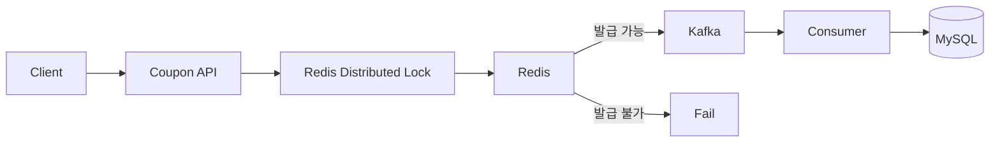
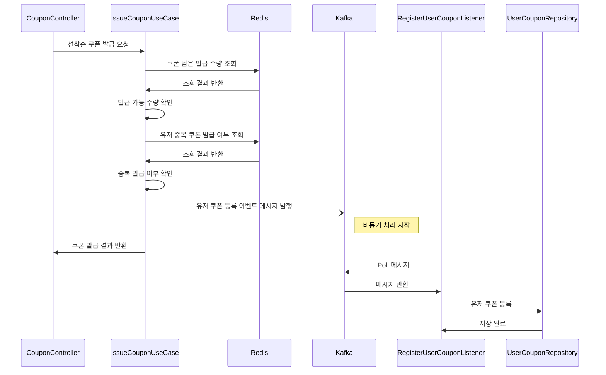
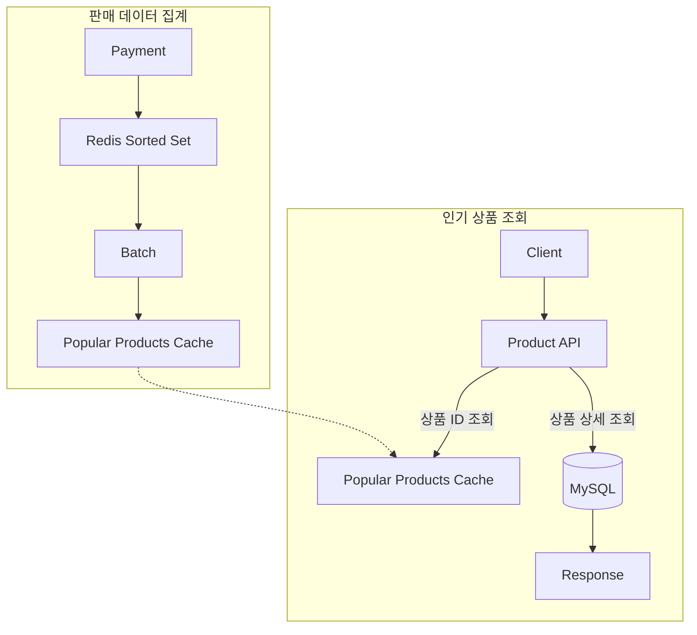
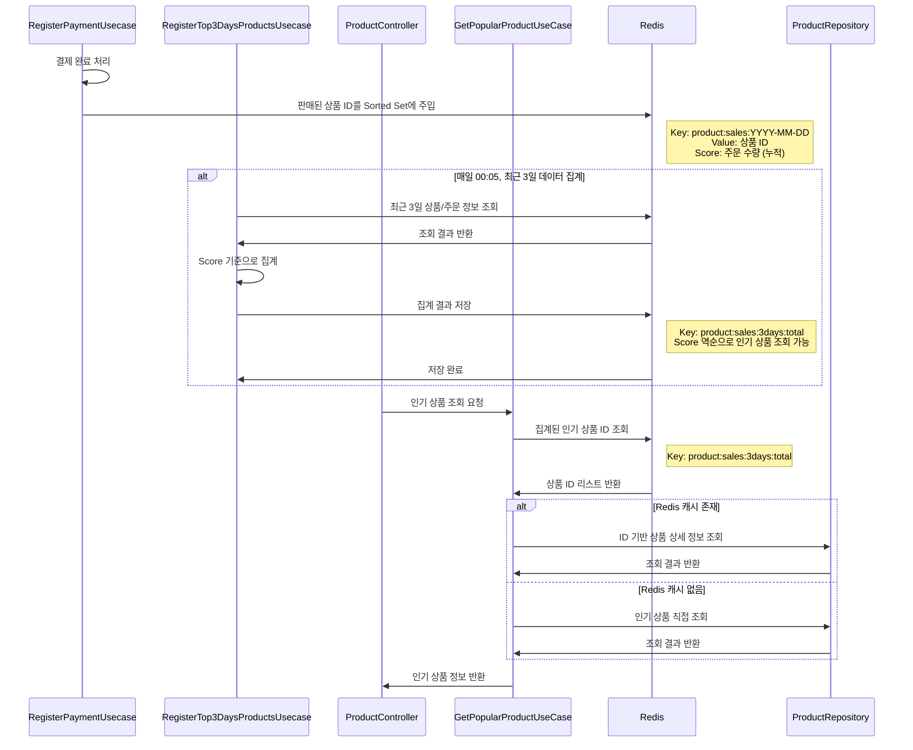
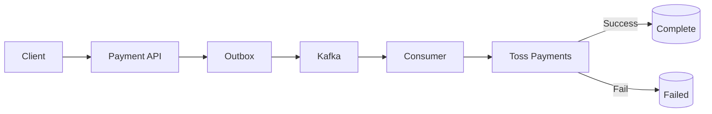
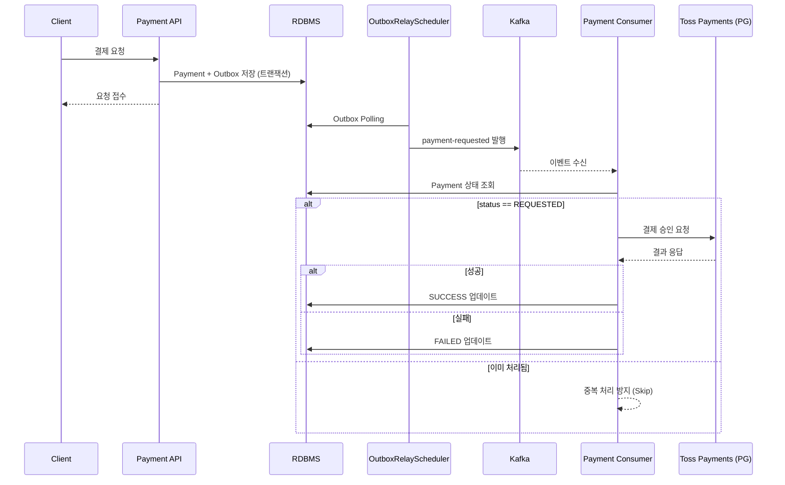

## 📚 목차

- [프로젝트 소개](#프로젝트-소개)
- [기술 스택](#기술-스택)
- [시스템 아키텍처](#시스템-아키텍처)
- [핵심 기술](#핵심-기술)
  - [선착순 쿠폰 발급](#선착순-쿠폰-발급)
  - [인기 판매 상품 조회](#인기-판매-상품-조회)
  - [결제 (Toss Payments)](#결제toss-payments)
- [기술적 의사 결정 과정](#기술적-의사-결정-과정)
- [DB 설계](#db설계)
- [성능 테스트](#성능-테스트)
  - [쿠폰 발급 성능 테스트](#선착순-쿠폰-발급-성능-테스트)
  - [인기 상품 조회 성능 테스트](#인기-상품-조회-성능-테스트)

<br>

## 프로젝트 소개
이커머스 서비스의 핵심 비즈니스 기능을 구현하고 실제 서비스 환경을 고려해 설계한 백엔드 프로젝트입니다.
<br>
대규모 트래픽 상황에서 발생하는 동시성 이슈와 데이터 정합성 문제를 해결하기 위한 아키텍처를 적용했습니다.

</br>

## 기술 스택
- **Backend** : Java 17, Spring Boot, Spring Data JPA, MyBatis
- **Database** : MySQL
- **Cache & Messaging** : Redis, Kafka
- **Testing** : JUnit 5, Mockito, AssertJ
- **Performance Testing** : K6
- **Infrastructure** : Docker, AWS EC2, AWS S3, AWS KMS
- **CI/CD** : GitHub Actions, Docker Hub

</br>

## 시스템 아키텍처


</br>
</br>

 
## 핵심 기술

### 선착순 쿠폰 발급





대규모 트래픽 환경에서 동시에 발생하는 쿠폰 발급 요청을 안정적으로 처리하기 위해 Redis와 Kafka를 활용한 비동기 처리 구조를 적용했습니다.

- Redis를 활용하여 쿠폰 잔여 수량과 중복 발급 여부를 관리했습니다.
- Redis 원자 연산을 통해 동시 요청 상황에서도 쿠폰 수량의 정합성을 보장했습니다.
- Kafka를 활용하여 쿠폰 발급 요청과 DB 저장 로직을 분리하여 DB 부하를 줄였습니다.
- Redis Distributed Lock을 적용하여 동시성 문제를 해결했습니다.

</br>

### 인기 판매 상품 조회






최근 3일간 판매량 기준 인기 상품 조회 시 반복적인 집계 쿼리로 인한 DB 부하를 개선하기 위해 Redis Sorted Set을 활용했습니다.

- 결제 완료 시 판매 데이터를 Redis Sorted Set에 저장했습니다.
- 배치를 통해 최근 3일간 판매 데이터를 집계하여 인기 상품 데이터를 관리했습니다.
- Redis에서 상품 ID를 조회한 후 DB에서 상세 정보를 조회하는 방식으로 데이터 정합성을 유지했습니다.
- 집계 데이터와 상품 데이터를 분리하여 조회 성능을 개선했습니다.

</br>

### 결제(Toss Payments)





외부 결제 시스템의 TPS 제한으로 인한 병목을 개선하기 위해 Kafka 기반 비동기 처리 구조를 적용하여 안정적인 결제 처리 시스템을 구현했습니다.

- 결제 요청부터 완료까지 상태를 관리하여 결제 흐름을 명확하게 분리했습니다.
- 외부 결제 API 호출 실패 상황을 고려하여 재시도 로직을 적용했습니다.
- Outbox Pattern을 활용하여 데이터 변경과 이벤트 발행 간의 정합성을 보장했습니다.

</br>

## 기술적 의사 결정 과정
- [#1] SSOT(Single Source of Truth)와 Redis 장애 시 쿠폰 재고 복구 아키텍처
</br>  https://jissu9.tistory.com/49

- [#2] 최종 일관성(Eventual Consistency)과 쿠폰 발급 아키텍처
</br>  https://jissu9.tistory.com/50

- [#3] 배치 집계 vs 이벤트 기반 실시간 집계 - 구현 방식과 장단점
</br>  https://jissu9.tistory.com/58

- [#4] DDD 기본 개념 정리 (전략적 설계와 전술적 설계)
</br>  https://jissu9.tistory.com/30

- [#5] 실무에서 바라본 의존성 역전 원칙(DIP)
</br>  https://jissu9.tistory.com/51

- [#6] 계층별 테스트 코드 작성 방법
</br>  https://jissu9.tistory.com/41

- [#7] 테스트 코드로 인한 설계 개선과 SOLID 원칙 적용 #1 (SRP)
</br>  https://jissu9.tistory.com/38

- [#8] Kafka의 메시지 전송 보장 방식(Message Delivery Guarantee)
</br>  https://jissu9.tistory.com/55

- [#9] Spring Boot + Kafka 기반 Outbox 패턴 구현하기
</br>  https://jissu9.tistory.com/46

</br>

## DB설계
### ERD


### Index 설계
인기 판매 상품 조회 기능의 DB Fallback 쿼리 성능을 개선하기 위해 Payment 테이블에 복합 인덱스를 적용했습니다.
```
CREATE INDEX idx_payment_status_createat_orderitem ON tbl_payment(create_at, payment_status, order_item_id);
```

</br>

## 성능 테스트

대규모 트래픽 환경에서 시스템 안정성을 검증하고, Redis 캐시 적용 전후의 성능 개선 효과를 확인하기 위해 K6 기반 부하 테스트를 진행했습니다.

### 선착순 쿠폰 발급 성능 테스트

쿠폰 발급 API는 특정 시간대에 요청이 집중되는 상황을 고려하여 부하 테스트를 진행했습니다.

- 테스트 조건
  - Virtual User: 1,000
  - Requests: 1,000 RPS
  - Duration: 60s

- 성능 검증 지표
  - 총 요청 수 : 60,001건
  - TPS : 999.98 req/s (목표 TPS 1,000 달성)
  - 평균 응답 시간 : 91.23ms
  - p95 응답 시간 : 354.61ms
  - 최대 응답 시간 : 515.79ms

- 검증 결과
  - Redis를 활용한 재고 관리와 Kafka 기반 비동기 처리를 통해 목표 TPS를 유지하면서도 초과 발급 없이 데이터 정합성을 보장했습니다.

<br>

### 인기 상품 조회 성능 테스트

Redis Sorted Set 기반 집계 캐시 적용 전후로 부하 테스트를 진행하여 성능 개선 효과를 검증했습니다.

- 테스트 목적
  - 기능 개선에 따른 성능을 측정하고, 부하 조건에서 성능 향상 여부를 확인하기 위해 수행

- 테스트 조건
  - Virtual User: 100
  - Requests: 1,000 RPS
  - Duration: 60s

- 성능 검증 지표 (개선 전 → 후)
  - 처리량 : 20,966 TPS → 59,717 TPS (약 2.85배 증가)
  - 평균 응답 시간 : 568.15ms → 10.51ms (약 54배 단축)
  - 최대 응답 시간 : 3.76s → 513.95ms (약 7배 단축)

- 검증 결과
  - 반복적인 집계 연산을 Redis Sorted Set으로 분리하여 조회 성능을 크게 개선했으며, 부하 상황에서도 안정적인 응답 시간을 유지했습니다.
